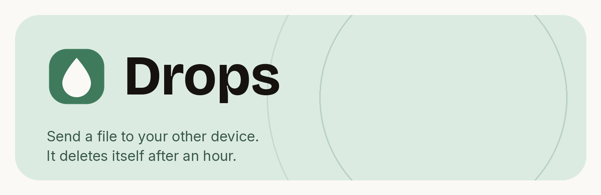
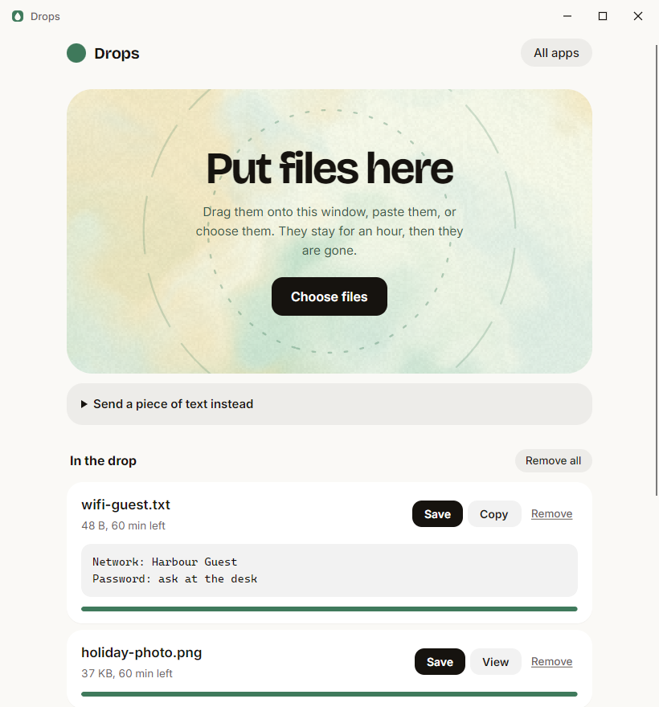
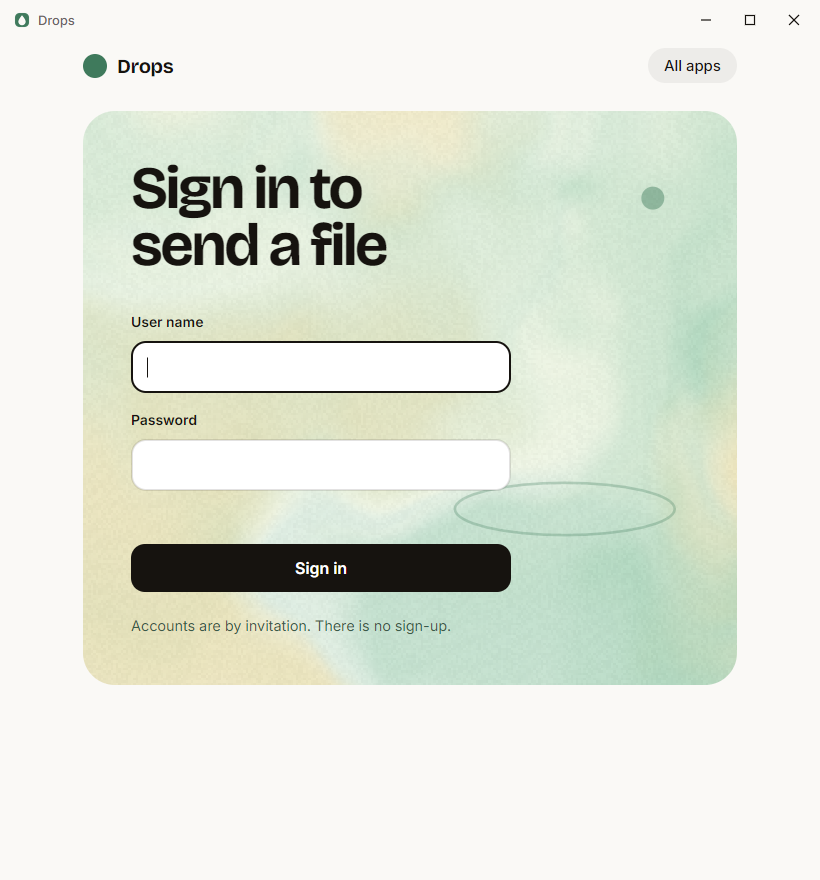

<p align="center">
  
</p>

<h1 align="center">Drops for desktop</h1>

<p align="center">
  Send a file to your other device, from a window and from the tray.<br />
  Everything deletes itself after an hour.
</p>

<p align="center">
  <a href="https://github.com/fezcode/drops-for-desktop/releases">Download</a>
  &nbsp;·&nbsp;
  <a href="#settings">Settings</a>
  &nbsp;·&nbsp;
  <a href="#building">Building</a>
  &nbsp;·&nbsp;
  <a href="#releasing">Releasing</a>
</p>

---

Drops for desktop is the native client for [Drops](https://drops.fezcode.studio), a temporary
file drop between your own devices. Put a file in on one device, take it out on another.

It is built with **Avalonia UI** and **C#**, and runs on **Windows, macOS and Linux**. It is not
a web view: every control is native, the interface is a one-to-one rebuild of the Drops page in
the Fezcode Studio "Daylight" kit, and it talks to the Drops server through its own API.

<p align="center">
  
  
</p>

## What it does

| | |
|---|---|
| **Put files in** | Drag them onto the window, paste them, or choose them. They are sent one at a time, so progress stays honest on a slow link. |
| **Send text** | A link, a note, a code. It arrives as a small text file you can copy with one click. |
| **Take files out** | Save a file anywhere, view pictures and video in your own viewer, copy text, or remove what you no longer need. |
| **Watch the clock** | Every file carries a gauge showing how long it has left before it deletes itself. |
| **Live in the tray** | Closing the window keeps Drops running. The tray icon tells you how many files are in the drop. |
| **Stay signed in** | The session is kept between runs, until you sign out from the tray. |

Accounts are by invitation. There is no sign-up.

### The tray menu

| Item | What it does |
|---|---|
| Show Drops | Brings the window forward. Clicking the tray icon does the same. |
| Send files… | Opens the file picker and sends what you choose. |
| Send clipboard | Sends the files on the clipboard, or its text if there are no files. |
| Sign out | Ends the session on this device and forgets it. |
| Quit | Stops Drops. |

## Install

Download the latest build from the [Releases](https://github.com/fezcode/drops-for-desktop/releases) page.

| System | File |
|---|---|
| Windows | `Drops-Setup-<version>.exe` |
| macOS, Apple Silicon | `Drops-<version>-osx-arm64.dmg` |
| macOS, Intel | `Drops-<version>-osx-x64.dmg` |
| Linux | `Drops-<version>-linux-x64.tar.gz` |

The macOS app is signed ad-hoc and not notarized. The first time, right-click it and choose **Open**.

## Settings

Drops keeps its settings and its session in the fezcode folder.

| System | Folder |
|---|---|
| Windows | `%APPDATA%\fezcode\Drops` |
| macOS | `~/Library/Application Support/fezcode/Drops` |
| Linux | `~/.config/fezcode/Drops` (follows `XDG_CONFIG_HOME`) |

Set the `DROPS_HOME` environment variable to use another folder.

**`settings.json`**

```json
{
  "server": "https://drops.fezcode.studio",
  "closeToTray": true,
  "width": 820,
  "height": 880
}
```

| Key | Meaning |
|---|---|
| `server` | The Drops server to use. Change it to point at your own. |
| `closeToTray` | `true` keeps Drops in the tray when the window is closed. `false` makes closing quit. |
| `width`, `height` | The window size, remembered between runs. |

**`session`** holds the sign-in session. On Windows it is encrypted for your user account. On
macOS and Linux it is a file only you can read. Signing out removes it. Your password is never
stored.

## Command line

```
Drops              open the window, or bring the running copy forward
Drops --hidden     start in the tray without opening the window
Drops --version    show the version
Drops --help       show help
```

Only one copy runs per user. Starting Drops again brings the running copy forward.

## Building

You need the **.NET 8 SDK** or newer.

```powershell
dotnet run
```

The project is one Avalonia application:

| Folder | Contents |
|---|---|
| `Views/` | The window: sign-in, the drop, the upload queue and the title bar. |
| `Controls/` | The moving parts of the kit, drawn in code: the colour field (a Skia shader), the rings and falling shapes, the logo mark and the time gauge. |
| `Services/` | The Drops API client, settings, and the saved session. |
| `Assets/` | Fonts, icons and README images, generated by `tools/make-assets.py`. |

## Releasing

The version lives in `<Version>` in `Drops.csproj`. Keep `[app] version` in `forge.toml` in step with it.

**1. Build the Windows installer.** It is made with [Forge](https://github.com/fezcode/Forge) from `forge.toml`:

```powershell
.\build-installer.ps1     # publish, then bundle dist\Drops-Setup-<version>.exe
```

**2. Tag and publish.**

```powershell
git tag vX.Y.Z
git push origin main vX.Y.Z
gh release create vX.Y.Z dist\Drops-Setup-X.Y.Z.exe --title "Drops vX.Y.Z" --notes "..."
```

**3. macOS and Linux follow on their own.** Publishing the release starts
`.github/workflows/unix-release.yml`, which builds the same tag on GitHub's runners and attaches
the `.tar.gz` and the two `.dmg` files. To try a Unix build locally:

```powershell
.\build-unix.ps1 -Rid linux-x64
```

## Credits

The typefaces are [Inter](https://rsms.me/inter/) and
[Bricolage Grotesque](https://github.com/ateliertriay/bricolage), both under the SIL Open Font
License. They are pinned to the weights the interface uses by `tools/make-assets.py`.

## License

MIT. See [LICENSE.txt](LICENSE.txt).
